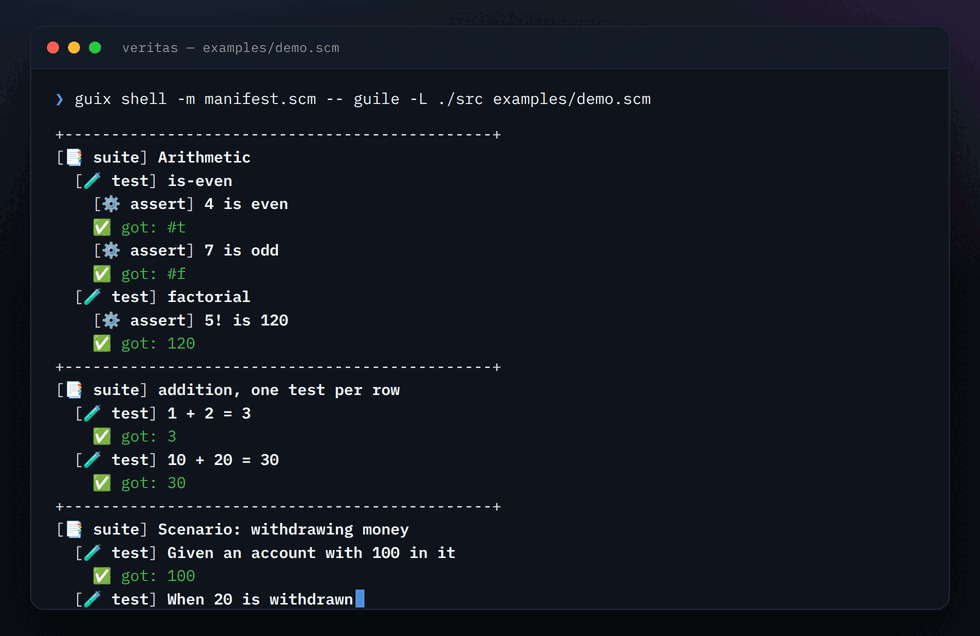
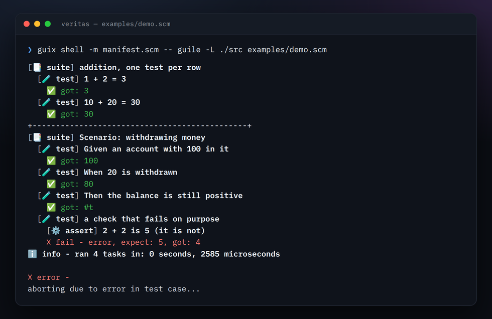

#+title: VERITAS
#+author: Josep Bigorra
#+email: jjbigorra@gmail.com
#+options: toc:nil
#+language: en

[[https://jointhefreeworld.org/ggg/dist/scheme-guile.svg]] [[https://jointhefreeworld.org/ggg/dist/gnu-guix.svg]] [[https://jointhefreeworld.org/ggg/dist/maak.svg]] [[https://jointhefreeworld.org/ggg/dist/license-lgpl3+.svg]] [[https://jointhefreeworld.org/ggg/dist/license-fdl13+.svg]] [[https://jointhefreeworld.org/ggg/dist/jointhefreeworld-org.svg]]

*VERITAS* — unit, integration and black-box testing for Guile Scheme, in a DSL that reads like the code it tests.

/One run of [[./examples/demo.scm][examples/demo.scm]]: a suite of assertions, a table of cases, a Given/When/Then scenario — and one check that fails on purpose, so you can see both halves of a report.  · [[./examples/demo.scm][Read the spec]]./

#+begin_export html

  

    An expressive, free and extensible test framework is a good instrument for
    exploring systems and algorithms.
  

  

#+end_export

Veritas helps you check that your software is correct, and see how it behaves. It gives tests a clear structure — *suites* group related *tests*, and *tests* hold *assertions* — and it reports what happened in a format you can read.

What makes ~veritas~ pleasant to use is the embedded domain-specific language: tests are ordinary Scheme, written with ~suite~, ~test~ and the ~assert-*~ procedures. Shuffling, concurrency, timeouts, table-driven tests, doubles, snapshots and a JUnit report come along for free: one Guile dependency, no plugins, no configuration file.

* At a glance
:PROPERTIES:
:CUSTOM_ID: at-a-glance
:END:

- *A test is a sentence.* ~(test "the cart is empty" (assert-true (cart-empty? cart)))~ is a whole test, and any assertion can carry a ~#:name~, so the report reads like the specification it is checking.
- *A full toolkit in one dependency.* 24 matchers (with Latin aliases), Given/When/Then scenarios, table-driven suites, spies and stubs, snapshots, generators, deadlines at four granularities, benchmarks, LCOV, Cobertura and JaCoCo coverage, tag filters, JSON and JUnit reports.
- *Fast, and reproducible when it matters.* Suites run over fibers, whole files run in worker processes (~--jobs~), a run can be sharded across machines (~--partition~), and every shuffled run prints the seed that replays it.
- *A failure you can act on.* The report names the suite, the test and the assertion, shows what was expected and what was got, and the run can be narrowed with ~--only-test~, ~--only-suite~, ~--only-tag~ or ~--only-failed~.
- *Yours to extend.* Assertions, reporters and generators are ordinary Guile procedures: a project-specific matcher is a function, not a plugin against an extension API.

In a hurry? [[#install][Install]] is two commands and [[#quick-start][Quick start]] is one file.

*Where to find things*

- Repository: [[https://codeberg.org/jjba23/veritas]]
- Full API documentation: [[https://jointhefreeworld.org/api-docs/veritas/API.html][jointhefreeworld.org/api-docs/veritas]]
- Manual page: [[./man/veritas.1][man/veritas.1]]
- Runnable demo: [[./examples/demo.scm][examples/demo.scm]]
- Real-world examples: the [[./test/veritas/unit][~test/veritas/unit~]] folder is this project's own test suite — the best place to see every feature used for real.
- Ideas, tickets, backlog: [[https://lucidplan.jointhefreeworld.org/tickets/veritas]]

*Status:* veritas is pre-1.0, and I am working to stabilize it, so expect changes until we reach v1.0.0. The surface that stays put is a small one: ~veritas-run~, ~suite~, ~test~ and the ~assert-*~ family.

* Contents
:PROPERTIES:
:CUSTOM_ID: contents
:END:

- [[#at-a-glance][At a glance]]
- [[#features][Features]]
- [[#ways-to-install][Ways to install]]
- [[#install][Install]]
- [[#quick-start][Quick start]]
- [[#how-veritas-works][How veritas works]]
- [[#assertions-and-matchers][Assertions and matchers]]
- [[#timeouts][Timeouts]]
- [[#behaviour-driven-testing][Behaviour-driven testing]]
- [[#data-driven-testing][Data driven testing]]
- [[#test-doubles][Test doubles]]
- [[#snapshots][Snapshots]]
- [[#container-testing][Container testing]]
- [[#generators][Generators]]
- [[#code-coverage][Code coverage]]
- [[#configuration][Configuration]]
- [[#runner][Runner]]
- [[#command-line-interface][Command line interface]]
- [[#how-veritas-compares][How Veritas compares]]
- [[#why-gnu-guix][Why GNU Guix?]]
- [[#ecosystem][Ecosystem]]
- [[#contributing][Contributing]]
- [[#license][License]]

* Features
:PROPERTIES:
:CUSTOM_ID: features
:END:

/QUIDQUID AGIS, PRUDENTER AGAS/ - whatever you do, do it wisely

Everything below is part of ~(veritas veritas)~ and its companion modules. There
is no runner to install, no adapter to register and no configuration file to
keep in sync.

** Writing tests that read well
:PROPERTIES:
:CUSTOM_ID: writing-tests-that-read-well
:END:

- ~suite~, ~test~ and the ~assert-*~ family: the hierarchy *is* the report. See
  [[#assertions-and-matchers][Assertions and matchers]].
- 24 matchers — equality, identity, approximation, containment, regexps,
  emptiness, length, ranges, membership — plus a Latin alias for each one. See
  [[#assertions-and-matchers][Assertions and matchers]].
- Given/When/Then scenarios in the spirit of Cucumber, with no extra runner. See
  [[#behaviour-driven-testing][Behaviour-driven testing]].
- Table-driven tests: ~test-each~, ~suite-each~ and ~cases->table~ turn a list of
  rows into suites and tests. See [[#data-driven-testing][Data driven testing]].
- Test doubles: ~make-spy~, ~make-stub~ and ~with-temporary-binding~. See
  [[#test-doubles][Test doubles]].
- Snapshots for any value Guile can read back, written on first run. See
  [[#snapshots][Snapshots]].
- Generators for property-style tests. See [[#generators][Generators]].
- A body is a sequence, so assertions inside a ~let~, a ~map~ or a helper
  procedure all run. See [[#what-a-body-contributes][What a body contributes]].

** Running a suite the way you need
:PROPERTIES:
:CUSTOM_ID: running-a-suite-the-way-you-need
:END:

- Deadlines on a whole suite, a single test, a benchmark or one assertion — an
  overrun is a failure, never a hung CI job. See [[#timeouts][Timeouts]].
- Suites run concurrently over fibers; benchmarks run sequentially, because the
  profiler is process-global.
- Seeded shuffling: every run prints the seed, and ~VERITAS_SEED~ replays it.
- Filters by test name, suite name, tag, or *the previous run's failures*.
- ~--jobs~ runs whole files in worker processes and merges their output,
  failure record and JUnit report; ~--partition 2/4~ runs one slice of them.
- Skip or tag any unit without touching the runner. See [[#configuration][Configuration]].

** Reporting
:PROPERTIES:
:CUSTOM_ID: reporting
:END:

- Five reporters: emoji (the default), monotone, JSON, JUnit XML, and one for
  GitHub Actions. See [[#reporters][Reporters]].
- Benchmarks report statistics from Guile's ~statprof~, next to the tests they
  measure.
- LCOV, Cobertura, JaCoCo, JSON and one-page HTML coverage with one keyword, merged across a whole run. See [[#code-coverage][Code coverage]].
- Every run ends with its totals: how many test files ran, and how many suites,
  tests and assertions they held between them.
- The exit status is part of the contract: ~0~ when everything passed, ~1~ when
  anything failed.

* Ways to install
:PROPERTIES:
:CUSTOM_ID: ways-to-install
:END:

/Four routes to the same 0.11.0, from the most automated to the most manual.  They all build the tag this README documents./

** From the Guix channel
:PROPERTIES:
:CUSTOM_ID: from-the-guix-channel
:END:
*GNU Guix* is the functional package manager this project is developed with: a build is a pure function of its inputs, so the same recipe gives the same result everywhere, and an upgrade that goes wrong can be rolled back.

The jointhefreeworld channel carries ~guile-veritas~ at 0.11.0, so a checkout of the channel is enough — no package definition to write:

#+begin_src shell
git clone https://codeberg.org/jjba23/guix-jointhefreeworld.git
guix install -L ./guix-jointhefreeworld guile-veritas
#+end_src

Add the channel to ~$HOME/.config/guix/channels.scm~ (the channel's README has the four lines) and a plain ~guix install guile-veritas~ keeps working on every later ~guix pull~.

** From the Nix flake
:PROPERTIES:
:CUSTOM_ID: from-the-nix-flake
:END:
*Nix* offers the same declarative, reproducible model with its own language, its own store and a binary cache, and it is a natural fit if the rest of your machine is already described in Nix.

The jointhefreeworld flake builds this project with this repository's own expression, so the package cannot drift from the source:

#+begin_src shell
nix build github:jjba23/nix-jointhefreeworld#guile-veritas
#+end_src

The same attribute is available as an overlay, so ~pkgs.jointhefreeworld.guile-veritas~ works inside a NixOS or home-manager configuration too.

** As a container image
:PROPERTIES:
:CUSTOM_ID: as-a-container-image
:END:
*Podman or Docker* is the route that puts nothing on the host: the ~Dockerfile~ in this repository builds the project in a builder stage and copies only what it installed into a runtime stage, so the image is small and the host keeps its own toolchain untouched.

#+begin_src shell
podman build -t veritas .   # docker build -t veritas . also works
podman run --rm -it veritas
#+end_src

The image's entry point is Guile, with veritas on its load path, which makes it useful for a quick try and for reproducing a bug on a clean system.

** As a distribution package
:PROPERTIES:
:CUSTOM_ID: as-a-distribution-package
:END:
*Debian, openSUSE and Arch* each get the project through their own package manager.  Packaging lives in this repository under ~packaging/~ and is pinned to the same release tag, so the recipes and the sources they build are versioned together.

None of the three archives ships veritas yet, so these are recipes to build rather than packages to install from a mirror:

| Distribution   | Package   | How to build it                                                                     |
|----------------+-----------+-------------------------------------------------------------------------------------|
| Debian, Ubuntu | ~veritas~ | copy ~packaging/debian~ to the repository root, then ~dpkg-buildpackage -us -uc -b~ |
| openSUSE       | ~veritas~ | ~osc build~ with ~packaging/opensuse~                                               |
| Arch           | ~veritas~ | ~makepkg -si~ in ~packaging/arch~                                                   |

Each recipe carries its own dependency list, so a missing library fails the build with its name rather than producing a package that cannot load.

** Which one?
:PROPERTIES:
:CUSTOM_ID: which-one
:END:
- *Guix* if you want the toolchain the project is tested with, and the ability to roll back a bad upgrade.
- *Nix* if the rest of your machine is already declarative; the flake pins nixpkgs and gives you a binary cache.
- *Container* if you only want to try the release, or reproduce a report on a machine that has nothing installed.
- *Distribution package* if you want the project managed by the same tool as the rest of your system, with its licence, manual page and launcher in the usual places.

* Install
:PROPERTIES:
:CUSTOM_ID: install
:END:

/COLLOCATIO ET USUS/ - placing, using

** Requirements
:PROPERTIES:
:CUSTOM_ID: requirements
:END:

- [[https://www.gnu.org/software/guile/][GNU Guile]] 3.0 or newer (developed against 3.0.9 and later)
- [[https://github.com/wingo/fibers][guile-fibers]] — the concurrency under suites and the deadline machinery
- [[https://github.com/aconchillo/guile-json][guile-json]] 4 — the JSON reporter and the JUnit document

That is the whole list. There is no test runner to install, no adapter to
register and no configuration file: ~(use-modules (veritas veritas))~ is the
setup.

** With GNU Guix (recommended)
:PROPERTIES:
:CUSTOM_ID: with-gnu-guix-recommended
:END:

Veritas is packaged in Guix officially, as ~guile-veritas~ (~0.1.6~ at the time
of writing). One command and you are done:

#+begin_src shell
guix install guile-veritas
#+end_src

Better still, pin it in your project's manifest so that everyone — and every CI
run — gets the same thing:

#+begin_src scheme
;; manifest.scm
(specifications->manifest
 (list "guile" "guile-fibers" "guile-json" "guile-veritas"))
#+end_src

#+begin_src shell
guix shell -m manifest.scm -- \
    guile -c '(use-modules (veritas veritas)) (display "veritas is ready\n")'
#+end_src

** From source
:PROPERTIES:
:CUSTOM_ID: from-source
:END:

#+begin_src shell
git clone https://codeberg.org/jjba23/veritas.git
cd veritas
guix shell -m manifest.scm -- \
    guile -L ./src -c '(use-modules (veritas veritas)) (display "veritas is ready\n")'
#+end_src

Anywhere else, put the ~src~ directory on Guile's load path — with
~-L /path/to/veritas/src~ on the command line, with ~add-to-load-path~ in your
script, or with ~GUILE_LOAD_PATH~ in your environment:

#+begin_src scheme
(add-to-load-path "/path/to/veritas/src")
(use-modules (veritas veritas))
#+end_src

#+begin_src shell
export GUILE_LOAD_PATH="/path/to/veritas/src:$GUILE_LOAD_PATH"
guile -c '(use-modules (veritas veritas)) (display "veritas is ready\n")'
#+end_src

The project's own manifest already carries Guile, fibers, JSON and the docs
tooling, so ~guix shell -m manifest.scm~ is all you need to hack on veritas
itself.

** A pinned version, as a Guix package
:PROPERTIES:
:CUSTOM_ID: a-pinned-version-as-a-guix-package
:END:

If you would rather not depend on the version Guix ships today, this is the
package definition the project uses; drop it in your own channel or manifest and
fill in the version and hash:

#+begin_src scheme
(define-public guile-veritas
  (package
    (name "guile-veritas")
    (version "x.x.x")
    (source
     (origin
       (method git-fetch)
       (uri (git-reference
             (url "https://codeberg.org/jjba23/veritas.git")
             (commit (string-append "v" version))))
       (file-name (git-file-name name version))
       (sha256
        (base32 "<dependent on version>"))))
    (build-system guile-build-system)
    (arguments
     (list
      #:source-directory "src"))
    (native-inputs (list guile-3.0))
    (propagated-inputs (list guile-fibers
                             guile-json-4)) ;; for versions >= 2.0.0
    (home-page "https://codeberg.org/jjba23/veritas")
    (synopsis "Testing framework for Guile")
    (description
     "Veritas is a testing framework for Guile with an @acronym{EDSL,
embedded domain specific language} to define test suites.  Emphasis is placed
on legible, maintainable tests.  Veritas shuffles tests and runs them
concurrently by default.")
    (license license:lgpl3+)))
#+end_src

** The command line launcher
:PROPERTIES:
:CUSTOM_ID: the-command-line-launcher
:END:

~bin/veritas~ is a thin launcher around ~(veritas cli)~: it turns the
environment variables into regular command line flags, puts ~./test~ on Guile's
load path and runs the runner. With the dependencies in scope:

#+begin_src shell
guix shell -m manifest.scm -- ./bin/veritas --help
guix shell -m manifest.scm -- ./bin/veritas
#+end_src

See [[#command-line-interface][Command line interface]] for every flag.

* Quick start
:PROPERTIES:
:CUSTOM_ID: quick-start
:END:

/AD REM/ - to the matter

It's easy to import Veritas and start using it:
#+begin_src scheme
(use-modules (veritas veritas))
#+end_src

We can define some simple Scheme functions to test with:
#+begin_src scheme
(define (is-even n)
  (= (modulo n 2) 0))

(define (factorial n)
  (if (= n 0) 1
      (* n
         (factorial (- n 1)))))

#+end_src

We can then write a test suite:
#+begin_src scheme
(define my-veritas-suite
  (suite "My First Veritas Test Suite"
         (test "is-even"
               (assert-true (is-even 4)
                            #:name "4 should be even")
               (assert-false (is-even 7)
                             #:name "7 should not be even"))
         (test "length"
               (assert-equal #:expect 0
                             #:got (length '())
                             #:name "length of empty list should be 0")
               (assert-equal #:expect 3
                             #:got (length '(a b c))
                             #:name "length of list with 3 elements should be 3"))
         (test "delayed computation"
               (assert-equal #:expect 144
                             #:got `(comp (begin
                                            ;; comp runs at test time, not while
                                            ;; the file is loaded.
                                            (let ((x 12))
                                              (* x x))))
                             #:name "Complex computation inside an assertion"))))

#+end_src

We can also write some benchmarks:
#+begin_src scheme
(define simple-factorial-benchmark
  (benchmark #:name "recursive computation of the factorial"
             #:runs 3
             #:thunk (lambda ()
                       (factorial 10000))))

#+end_src

And then we wire it all up:
#+begin_src scheme
(define (spec)
  (veritas-run #:debug? #f
               my-veritas-suite
               ;; you can directly pass tests or suites too
               (test "some test without suite"
                     (assert-equal #:expect 1
                                   #:got (* 1 1 1 1)))
               ;; you can also pass benchmarks
               simple-factorial-benchmark))

#+end_src

Save that as ~my-tests.scm~ and run it:

#+begin_src shell
guix shell -m manifest.scm -- guile -L ./src my-tests.scm
#+end_src

A passing run prints the report and ends with how many tasks ran and how long
they took. A failing one names each failed assertion, shows the expectation and
the value it got, and exits with status 1 — which is what a CI job reads.

[[https://jointhefreeworld.org/static-assets/veritas/screen-2026-09-24-09-25-36.png]]

Normal arguments are denoted by their name; keyword arguments are denoted by
their name prefixed with ~#:~, as in Scheme, and they may be written before or
after the body forms — the DSL picks them out either way. When ~rest~ arguments
are mentioned, it is another word for variadic.

Prefer to let the runner discover your files? Put them under
~test/<your-module>/unit/~ and see [[#runner][Runner]].

* How veritas works
:PROPERTIES:
:CUSTOM_ID: how-veritas-works
:END:

/EX LABORE VENUSTAS/ - /from hard work, beauty/

~veritas~ is small and opinionated, which keeps the learning curve low, whether you are new to testing or have been at it for years.

Tests are plain Scheme (Guile) code, so you can abstract, reuse and customize them however you like.

The hierarchy is defined as follows:
- In a test file, define a no-argument function called ~spec~ and export it. It holds your ~veritas-run~ statements and is what the built-in runner calls. Run your tests another way and ~spec~ is not required.
- ~veritas-run~ takes an arbitrary (variadic) amount of ~suite~ items, ~test~ items or ~benchmark~ items.
- ~suite~ takes a variadic amount of ~test~ items, and may itself contain other suites. Suites and tests can therefore be nested to any depth; see the ~nesting~ unit tests for a five-level example.
- ~test~ takes a body: forms that build assertions (~assert-equal~, ~assert-error~, ~assert-true~, etc.). Every assertion the body builds is a case, so a ~let~, a ~map~ or a helper procedure is as good as a list of checks.
- ~benchmark~ takes a ~name~, a number of ~runs~ and a ~thunk~ to be measured. This is currently done by using ~statprof~.

~test~ and ~suite~ are macros that run nothing when the file is loaded. Each body form becomes a thunk, and calling the macro returns a closure over its name, its body and its flags. A body is therefore evaluated when its task runs, which is what lets the runner choose the order, the concurrency and the timing of a run, and capture each test's output on its own port.

Tests, or whole suites, can then run in parallel over cooperative fibers, which cuts down the wall clock time of a run. Suites are concurrent by default; ~#:concurrent? #f~ serializes them.

Refer to ~maak.scm~ for the tasks available in this project (compile, test, docs, deploy, and more).

** When a body is evaluated
:PROPERTIES:
:CUSTOM_ID: when-a-body-is-evaluated
:END:

A file of tests is *built* when Guile loads it and *run* afterwards, and knowing which parts live in which half of that split accounts for most surprises in a Veritas file. ~test~, ~suite~, ~scenario~ and the BDD steps are macros: each body form is wrapped in a thunk and evaluated when its task runs. So a body is a program the runner executes, and the arguments of the assertions in it - ~#:expect~, ~#:got~, ~#:name~, ... - are computed at that moment too, in the order you wrote them.

A body form can therefore build any number of assertions, and all of them run:

#+begin_src scheme
(test "a body is a sequence"
      ;; printed while the test runs, in this order
      (display "preparing\n")
      (let ((xs '(1 2 3)))
        (assert-equal #:expect 3 #:got (length xs))   ;; both run
        (assert-true (pair? xs))))
#+end_src

This table is the whole story.

| written as                                                        | evaluated when                               |
|-------------------------------------------------------------------+----------------------------------------------|
| a form in a ~test~, ~suite~ or ~scenario~ body                    | that test or suite runs, top to bottom       |
| the arguments of an assertion: ~#:expect~, ~#:got~, ~#:name~, ... | with the body form that builds the assertion |
| a ~comp~ payload in ~#:got~                                       | the assertion runs                           |
| the thunk of ~assert-error~, ~assert-no-error~ or ~assert-raises~ | the assertion runs                           |
| the body of a ~#:before~ or ~#:after~ hook                        | its test runs, around that test's cases      |
| the body of a ~#:before-all~ or ~#:after-all~ hook                | its suite runs, around all of its children   |
| a benchmark's ~#:thunk~                                           | once per ~#:runs~, while the benchmark runs  |

Four things follow from that split.

- Setup written in a body happens at test time, in order, and a test that raises while its body is being evaluated fails like any other: you get a failing test, not a file that refuses to load.
- A body that builds no assertions at all is reported as a *failure*. A check that quietly disappears looks exactly like a passing test, so it is not allowed to.
- Assertions outside a body - a top-level ~(assert-equal ...)~, or one built at load time and bound to a variable - are only values there. They run when something runs them: pass them into a ~test~ or apply them to a validation client yourself.
- What you write top to bottom inside a body is the order the work happens in - a body is a sequence, so it is not shuffled unless you ask for ~#:shuffle? #t~, which is a way to catch checks that depend on each other by accident. Around that, a suite's tests run concurrently by default and a suite's children are shuffled, so share state through a hook rather than through the order of tests.

*** Delaying an argument with comp
:PROPERTIES:
:CUSTOM_ID: delaying-an-argument-with-comp
:END:

Delay an argument by writing the computation as data: a quoted list starting with ~comp~.

#+begin_src scheme
(assert-equal #:expect 144
              #:got `(comp (* 12 12)))
#+end_src

~compute~ and ~computare~ are aliases of ~comp~. The quote matters, since an unquoted ~(comp ...)~ would be a call to a procedure of that name. Nothing else is special, so an ordinary quoted list such as ~'(1 2 3)~ is still compared as a value.

Bodies already run at test time, so ~comp~ is no longer needed to delay setup. It is still how you put work *inside* the assertion instead of next to it, which is what a deadline on the assertion covers: ~(assert-equal #:got `(comp (slow-call)) #:timeout 2)~ aborts ~(slow-call)~ when it overruns, while a plain ~#:got~ is computed before the assertion starts and is not under its deadline.

The payload is evaluated with ~eval~ in the interaction environment, and under the runner that environment is the bare top level: core Scheme is there, the imports and the definitions of your test file are not. ~(comp (my-helper))~ raises ~unbound-variable: my-helper~, and ~(comp (call-with-input-file "f" get-string-all))~ fails as well, even though the same file imports the module that provides ~get-string-all~. Either way the runner reports a task error rather than a failed assertion. Keep ~comp~ payloads to core Scheme - arithmetic, ~let~, ~sleep~ - and reach your own code by preparing state at test time instead.

*** Preparing state at test time
:PROPERTIES:
:CUSTOM_ID: preparing-state-at-test-time
:END:

The thunk-based assertion runs at test time, with everything the module imported:

#+begin_src scheme
(test "writes and reads a file at test time"
      (assert-no-error
       (lambda ()
         (call-with-output-file "greeting.txt"
           (lambda (port) (display "hello" port)))
         (let ((content (call-with-input-file "greeting.txt" get-string-all)))
           (unless (equal? content "hello")
             (error "expected hello, got ~a" content))))))
#+end_src

~assert-no-error~ only looks for an exception, and passes whatever the thunk returns, so the thunk does the comparing and calls ~error~ when it is wrong. ~assert-error~ is the mirror image, for the checks where raising is the expected outcome.

When the comparison itself has to happen at run time, a case can be a lambda that applies the assertion to the client it is handed:

#+begin_src scheme
(test "reads the file it wrote"
      (lambda (vc)
        (call-with-output-file "total.txt"
          (lambda (port) (display "6" port)))
        ((assert-equal #:expect "6"
                       #:got (call-with-input-file "total.txt" get-string-all))
         vc)))
#+end_src

Hooks run at run time too, and they bracket the assertions: inside a test, the cases run after ~#:before~ and before ~#:after~; inside a suite, the children run after ~#:before-all~ and before ~#:after-all~. A hook body is a closure from your own file, so unlike a ~comp~ payload it may call anything the module defines.

#+begin_src scheme
(suite "with a fresh database"
       #:before-all (lambda (vc) (create-tables!))
       #:after-all (lambda (vc) (drop-tables!))
       (test "the table starts empty"
             (assert-equal #:expect 0 #:got (row-count))))
#+end_src

** What a body contributes
:PROPERTIES:
:CUSTOM_ID: what-a-body-contributes
:END:

A body is read for what it *builds*, not for the value of its last expression. The first is that a form may build as many assertions as it likes, and all of them run:

#+begin_src scheme
;; a let, a for-each, a map or a helper procedure: every assertion built counts
(test "wrapped assertions all run"
      (let ((xs '(1 2 3)))
        (assert-equal #:expect 3 #:got (length xs))
        (assert-true (pair? xs))))

(test "one assertion per case"
      (map (lambda (n)
             (assert-equal #:expect n #:got (+ 1 (- n 1))))
           '(1 2 3)))

(define (cart-checks size full?)
  (list (assert-equal #:expect 2 #:got size)
        (assert-true full?)))

(test "built by a helper" (cart-checks 2 #t))
#+end_src

The other consequence is that an assertion used as the *input* of another assertion stays an input. In ~(assert-true (list? (assert-something ...)))~ the inner assertion runs where it stands, and is not also run again as a case of its own.

When the cases are built at run time, the procedures behind the macros take them exactly as a body would: ~%test~ and ~%suite~. That is what a table or a loop over cases uses, and it is why ~test-each~ and friends can build tests dynamically.

#+begin_src scheme
(apply %test "one assertion per case"
       (map (lambda (n)
              (assert-equal #:expect n #:got (+ 1 (- n 1))))
            '(1 2 3)))
#+end_src

* Assertions and matchers
:PROPERTIES:
:CUSTOM_ID: assertions-and-matchers
:END:

/PROBATIO ET REFUTATIO/ - proof and disproof

Assertions are the atoms of a Veritas run: each one returns a check that is evaluated during the test and reported as a pass or a fail. Give an assertion a ~#:name~ to make the report readable, and a ~#:timeout~ (in seconds) to bound how long it may take; see [[#timeouts][Timeouts]].

Core equality and boolean assertions:

#+begin_src scheme
(assert-equal #:expect 3 #:got (+ 1 2) #:name "1 + 2 is 3")
(assert-eq #:expect 'foo #:got 'foo)          ;; identity, eq?
(assert-eqv #:expect 42 #:got (+ 40 2))       ;; value, eqv?
(assert-not-equal #:expect '(1 2 3) #:got '(1 2 4))
(assert-not-eq #:expect (list 1) #:got (list 1))
(assert-not-eqv #:expect 1 #:got 2)
(assert-true (> 5 2) #:name "5 beats 2")
(assert-false (string=? "guile" "GUILE"))
#+end_src

Approximate (floating point) comparisons take an optional ~#:epsilon~:

#+begin_src scheme
(is-approximate? 3.14159 3.14160 #:epsilon 0.0001) ;; => #t
(assert-approximate #:expect 3.14 #:got 3.141 #:epsilon 0.01)
(assert-not-approximate #:expect 3.14 #:got 3.5 #:epsilon 0.01)
#+end_src

Any ~#:got~ can be pushed into the assertion itself by quoting it and wrapping the computation in ~comp~ (aliases: ~compute~ and ~computare~), which is how work ends up under that assertion's own ~#:timeout~. What that covers, and where it stops, is in [[#when-a-body-is-evaluated][When a body is evaluated]].

Error handling is first-class:

#+begin_src scheme
;; passes when the thunk raises an error, fails otherwise
(assert-error (lambda () (/ 1 0)))
;; passes when the thunk does not raise
(assert-no-error (lambda () (+ 1 2)))
;; assert-error with expected-error matching
(assert-raises (lambda () (/ 1 0)))
(assert-raises (lambda () (+ 1 'a)) #:on 'wrong-type-arg)
(assert-raises (lambda () (error "boom"))
               #:predicate (lambda (key args) (equal? key 'misc-error)))
#+end_src

Veritas also ships higher-level *matchers* in the spirit of RSpec, Jest's ~expect~ and AssertJ. They are ordinary assertions, so reporting stays uniform:

#+begin_src scheme
;; containment: substring for strings, membership for lists and vectors,
;; key membership for hash tables
(assert-contains #:expect '(1 2 3) #:got 2)
(assert-contains #:expect "hello world" #:got "world")
(assert-contains #:expect #(1 2 3) #:got 2)
(assert-not-contains #:expect '(1 2) #:got 9)

;; regular expressions (pattern is a string or a compiled regexp)
(assert-matches #:pattern "^[a-z]+@[a-z]+$" #:got "user@host")
(assert-not-matches #:pattern "^x" #:got "hello")

;; emptiness, length and membership
(assert-empty #:got '())
(assert-empty #:got "")
(assert-not-empty #:got '(1 2 3))
(assert-length #:expect 3 #:got '(1 2 3))
(assert-length #:expect 5 #:got "hello")
(assert-one-of #:expect '(red green blue) #:got 'green)

;; inclusive ranges
(assert-in-range #:min 1 #:max 10 #:got 5)
#+end_src

The whole family is re-exported by ~(veritas veritas)~, so no extra import is needed. See ~test/veritas/unit/matchers.scm~ for every matcher exercised against both passing and failing inputs.

** Latin aliases
:PROPERTIES:
:CUSTOM_ID: latin-aliases
:END:

/PROBATIO LATINA/ - the Latin proof

In the same spirit as the Latin BDD steps (see below), every assertion has a Latin alias. An alias is bound to the very same procedure as its English name, so the keyword arguments, the semantics and the reporting are identical: pick whichever reads best in your test. The aliases are re-exported by ~(veritas veritas)~ too, so no extra import is needed.

| Latin alias       | English assertion        | Meaning                                    |
|-------------------+--------------------------+--------------------------------------------|
| ~proba~           | ~assert~                 | core combinator ("prove")                  |
| ~aequalis~        | ~assert-equal~           | equal (structural, ~equal?~)               |
| ~idem~            | ~assert-eq~              | the same (identity, ~eq?~)                 |
| ~aequivalens~     | ~assert-eqv~             | equivalent (~eqv?~)                        |
| ~non-aequalis~    | ~assert-not-equal~       | not equal                                  |
| ~non-idem~        | ~assert-not-eq~          | not the same                               |
| ~non-aequivalens~ | ~assert-not-eqv~         | not equivalent                             |
| ~verus~           | ~assert-true~            | true                                       |
| ~falsus~          | ~assert-false~           | false                                      |
| ~propinquus?~     | ~is-approximate?~        | close? (predicate)                         |
| ~propinquus~      | ~assert-approximate~     | close (within ~#:epsilon~)                 |
| ~non-propinquus~  | ~assert-not-approximate~ | not close                                  |
| ~errat~           | ~assert-error~           | it errs (thunk raises)                     |
| ~non-errat~       | ~assert-no-error~        | it does not err (thunk is clean)           |
| ~suscitat~        | ~assert-raises~          | it raises, optionally ~#:on~/~#:predicate~ |
| ~continet~        | ~assert-contains~        | it contains                                |
| ~non-continet~    | ~assert-not-contains~    | it does not contain                        |
| ~congruit~        | ~assert-matches~         | it matches (regexp)                        |
| ~non-congruit~    | ~assert-not-matches~     | it does not match                          |
| ~inanis~          | ~assert-empty~           | empty                                      |
| ~non-inanis~      | ~assert-not-empty~       | not empty                                  |
| ~longitudo~       | ~assert-length~          | length                                     |
| ~intra~           | ~assert-in-range~        | within (inclusive range)                   |
| ~unus-ex~         | ~assert-one-of~          | one of                                     |

#+begin_src scheme
;; the same tests, written in Latin
(proba #:expect 3 #:got (+ 1 1 1) #:compare equal?)
(aequalis #:expect '(1 2 3) #:got '(1 2 3))
(verus (> 5 2) #:name "5 beats 2")
(falsus (string=? "guile" "GUILE"))
(propinquus #:expect 3.14 #:got 3.141 #:epsilon 0.01)
(errat (lambda () (/ 1 0)))
(suscitat (lambda () (+ 1 'a)) #:on 'wrong-type-arg)
(continet #:expect "hello world" #:got "world")
(congruit #:pattern "^[a-z]+@[a-z]+$" #:got "user@host")
(inanis #:got '())
(longitudo #:expect 3 #:got '(1 2 3))
(intra #:min 1 #:max 10 #:got 5)
(unus-ex #:expect '(red green blue) #:got 'green)
#+end_src

* Timeouts
:PROPERTIES:
:CUSTOM_ID: timeouts
:END:

/FESTINA LENTE/ - /make haste slowly/

A test, a suite, a benchmark and even a single assertion can be given a
~#:timeout~: the number of seconds it may run for. When the deadline passes the
unit is aborted and reported as a failed assertion, so a hang becomes an
ordinary failure instead of a run that never ends.

#+begin_src scheme
(test "the payment service answers"
      #:timeout 5                       ;; seconds, real numbers allowed
      (assert-equal #:expect "ok" #:got (call-payment-service)))

(suite "integration"
       #:timeout 30
       payment-suite
       database-suite)

(benchmark #:name "sorting 10k items"
           #:runs 3
           #:timeout 10
           #:thunk (lambda () (sort (iota 10000) <)))

(test "lazy payloads are covered too"
      (assert-equal #:expect '(1 2 3)
                    #:got `(comp (fetch-remote-list))  ;; runs at test time, lazy evaluation
                    #:timeout 2))
#+end_src

~#:timeout~ defaults to ~#f~, meaning "no deadline", so existing tests and
suites are unaffected. Units nest and each one keeps its own deadline: a suite
with ~#:timeout 30~ may hold a test with ~#:timeout 5~.

A timeout is meant to make a run finish, not to silence it: an overrunning unit
is reported as a *failure* (the message names the unit and the deadline, for
example ~a hanging test with a deadline timed out after 0.3 seconds~) and
~veritas-run~ exits with a non-zero status. Errors are never swallowed either: a
timed unit that raises still raises, exactly like an untimed one.

** What gets killed
:PROPERTIES:
:CUSTOM_ID: what-gets-killed
:END:

The timed unit runs in its own fiber. When the deadline passes, a watchdog
aborts that fiber, which unwinds it back to the boundary of the unit and gets it
off the scheduler, instead of leaving it spinning in the background. A fiber
suspended in a blocking wait cannot be unwound from the outside, so for those
the caller simply stops waiting: the deadline is enforced by the caller's own
timer, the run continues, and the abandoned fiber is discarded when the
scheduler that owns it finishes.

** What is covered
:PROPERTIES:
:CUSTOM_ID: what-is-covered
:END:

- For ~test~ and ~suite~ the deadline covers everything the unit does while it
  runs: its lifecycle hooks (~#:before~, ~#:after~, ~#:before-all~,
  ~#:after-all~) and every nested test.
- For ~benchmark~ it covers all of its ~#:runs~ together (a benchmark that
  overruns its deadline is reported as a failure as well).
- For an assertion it covers the assertion's own execution: the comparison and
  the computation of a lazy ~comp~ payload, or whatever the thunks passed to
  ~assert-error~, ~assert-no-error~ and ~assert-raises~ do when they are called.

An eager ~#:got~ is not covered by a deadline: it is computed while the body
form that holds it runs, before the assertion itself starts. What a deadline
covers is the assertion's own work - the comparison, a ~comp~ payload, whatever
the thunks of ~assert-error~ and friends do - so defer what must be cut short. See [[#when-a-body-is-evaluated][When a body is evaluated]].

Deadlines are read from a real clock, so fractional seconds are fine; a
~#:timeout~ of ~0.3~ is a useful smoke test when you are trying to reproduce a
hang.

See ~test/veritas/unit/timeout.scm~ for every case exercised, including the
proof that the fiber of an overrunning unit is really aborted.

* Behaviour-driven testing
:PROPERTIES:
:CUSTOM_ID: behaviour-driven-testing
:END:

/MORES ET SPECIES/ - habits and appearances

For Given/When/Then scenarios in the spirit of Cucumber / Gherkin, Veritas ships a small BDD layer in ~(veritas bdd)~. A scenario is just a suite whose steps are ordinary tests, so every reporter, filter and runner feature keeps working.

#+begin_src scheme
(use-modules (veritas bdd))

(define greeting-scenario
  (scenario "greeting a user by name"
    (given "a user named Ada"                    ;; Given
      (assert-equal #:expect "Ada" #:got (user-name ada)))
    (when-step "the user is greeted"             ;; When
      (assert-equal #:expect "Hello, Ada!" #:got (greet ada)))
    (then "the greeting is personalised"         ;; Then
      (assert-true (string-prefix? "Hello" (greet ada))))
    (and-step "the name is included"             ;; And
      (assert-contains #:expect (greet ada) #:got "Ada"))
    (but-step "no title is used"                 ;; But
      (assert-not-matches #:pattern "^Hello, (Mr|Ms)" #:got (greet ada)))))
#+end_src

Steps run in declaration order: scenarios disable shuffling and concurrency by default, so a ~Given~ always precedes its ~When~ and ~Then~. Scenarios accept the same lifecycle keywords as ~suite~ (~#:before-all~, ~#:after-all~, ~#:skip?~, ~#:concurrent?~, ~#:timeout~), and since a step is an ordinary test it can carry its own ~#:timeout~ too.

The scenario keyword is also available as ~feature~, ~story~, ~fabula~ and ~scaena~, and every step has a Latin alias: ~dato~ (~given~), ~quando~ (~when-step~), ~tunc~ (~then~), ~etiam~ (~and-step~) and ~sed~ (~but-step~). The When step is called ~when-step~ because Guile's core ~when~ is syntax and importing a conflicting binding would break ~(when ...)~ for the whole module. The Latin ~quando~ is unshadowed and reads naturally:

#+begin_src scheme
(define latin-scenario
  (fabula "a scenario written in latin"
    (dato "a list of two numbers"
      (assert-equal #:expect 2 #:got (length '(10 20))))
    (quando "the numbers are summed"
      (assert-equal #:expect 30 #:got (+ 10 20)))
    (tunc "the total is thirty"
      (assert-equal #:expect 30 #:got (+ 10 20)))))
#+end_src

The three main steps also have PascalCase aliases: ~Given~ (~given~), ~When~ (~when-step~) and ~Then~ (~then~). Being capitalised, they do not collide with Guile's lowercase ~when~, so the step can carry the name you expect to read:

#+begin_src scheme
(define pascal-scenario
  (scenario "summing a list of numbers"
    (Given "a list of three numbers"
      (assert-equal #:expect 3 #:got (length '(1 2 3))))
    (When "the numbers are summed"
      (assert-equal #:expect 6 #:got (apply + '(1 2 3))))
    (Then "the total is six"
      (assert-equal #:expect 6 #:got (apply + '(1 2 3))))))
#+end_src

Steps share state the way any Scheme code does: close over a ~let~ in the scenario body. All the steps of that ~let~ run, because a scenario body is read for the steps it builds, not for the value of its last expression.

#+begin_src scheme
(scenario "withdrawing too much"
  (let ((account (make-account 100)))
    (given "an account with 100"
      (assert-equal #:expect 100 #:got (account-balance account)))
    (when-step "150 is withdrawn"
      (assert-false (withdraw account 150)))
    (then "the balance is unchanged"
      (assert-equal #:expect 100 #:got (account-balance account)))))
#+end_src

The same holds inside a step: a ~let~ body there contributes every assertion it builds, and steps still run in declaration order.

* Data driven testing
:PROPERTIES:
:CUSTOM_ID: data-driven-testing
:END:

/PROBATIO EX DATIS/ - a.k.a. table-driven testing

Lisp makes this easy: higher order functions, quasi-quoting, ~map~, whatever fits. A body contributes every assertion it builds, so a mapped list of checks is a test with one case per row, and the same trick works at the suite level with a mapped list of tests.

#+begin_src scheme
(define log-level-suite
  (suite "Log Level"
         (test "is-in-log-level?"
               (map (lambda (c)
                      (if (caddr c)
                          (assert-true (is-in-log-level? (car c)
                                                         (cadr c))
                                       #:name (format #f
                                                      "~a is allowed in ~a"
                                                      (car c)
                                                      (cadr c)))
                          (assert-false (is-in-log-level? (car c)
                                                          (cadr c))
                                        #:name (format #f
                                                       "~a is not allowed in ~a"
                                                       (car c)
                                                       (cadr c)))))
                    '((trace trace #t)
                      (trace debug #f)
                      (trace info #f)
                      ;; ...... and so on
                      (error warn #t)
                      (error error #t)))))
#+end_src

Veritas also ships a dedicated, declarative *table* API in ~(veritas table)~. ~test-each~ expands a list of cases into one test per case, so a failure points at the exact input. ~suite-each~ does the same at the suite level (each case becomes its own nested suite), and ~cases->table~ indexes a case list by a key for named columns.

#+begin_src scheme
(use-modules (veritas table))

(define addition-suite
  (test-each "integer addition"
             '((0 0 0) (1 2 3) (10 20 30) (-1 1 0))
             (lambda (case)
               (let ((a (list-ref case 0))
                     (b (list-ref case 1))
                     (expected (list-ref case 2)))
                 (test (format #f "~a + ~a = ~a" a b expected)
                       (assert-equal #:expect expected #:got (+ a b)))))))

;; each case becomes its own nested suite
(define emptiness-suite
  (suite-each "collection emptiness"
              '(("" #t) ("x" #f))
              (lambda (case)
                (let ((s (list-ref case 0))
                      (expected (list-ref case 1)))
                  (suite (format #f "string ~s" s)
                         (test "emptiness matches"
                               (assert-equal #:expect expected
                                             #:got (string=? s ""))))))))

;; name the columns of a table explicitly
(cases->table '((:a 1) (:b 2)) car) ;; => ((:a :a 1) (:b :b 2))
#+end_src

Every generated case is an ordinary test or suite, so it is shuffled and reported like any other. Use ~#:shuffle?~ (default ~#t~) and ~#:concurrent?~ (default ~#f~) to control order and concurrency.

* Test doubles
:PROPERTIES:
:CUSTOM_ID: test-doubles
:END:

/PRO PERSONA/ - /standing in for the role/

Scheme needs less of a mocking library than most languages do: a procedure can be
passed in, so a fake is often just a lambda. What is worth having is a record of
what was called, and ~(veritas mock)~ keeps it.

~make-spy~ wraps a procedure and records every call and every result, read back
with ~spy-calls~, ~spy-results~, ~spy-call-count~ and ~spy-called-with?~.
~make-stub~ is a spy that ignores its arguments and returns a fixed value. A spy
is an ordinary procedure, so it can be passed, stored and mapped like the thing
it replaces.

#+begin_src scheme
(use-modules (veritas mock))

(test "the receipt is sent once"
      (lambda (vc)
        (let ((send (make-spy (lambda (who what) (list who what)))))
          (send "ada" "thanks")
          ((assert-called-with send '("ada" "thanks")) vc)
          ((assert-call-count send #:expect 1) vc))))
#+end_src

The assertions read the spy when they run rather than when they are built, so
they see the calls the body made before them. A body can also be a case lambda
that applies each check to the validation client itself, which is the older
style and still works:

~with-temporary-binding~ swaps a module binding for the length of a thunk and
puts the original back even when the thunk raises:

#+begin_src scheme
(use-modules (veritas mock))

(define module (resolve-module '(my app)))

(with-temporary-binding module 'now
                        (lambda () 0)
                        (lambda () (module-ref module 'now)))   ;; => 0
#+end_src

One honest limit, measured on Guile 3.0: Guile resolves a call to a known
procedure while it compiles, so a call site inside a module declared
~#:declarative? #t~ (the default) keeps calling the original procedure even while
the binding is changed. Code that reads the binding while running sees the
substitution instead: ~module-ref~, anything passed to ~eval~, and call sites in
a module declared ~#:declarative? #f~. That is why the ordinary Scheme answer
comes first - pass the dependency in, or hand the caller a spy.

* Snapshots
:PROPERTIES:
:CUSTOM_ID: snapshots
:END:

/IMAGO VERITATIS/ - /an image of the truth/

~(veritas snapshot)~ compares a value with the one recorded the first time the
check ran. A missing snapshot is written and the check passes, so a new test does
not fail merely for being new; a mismatch fails and shows both sides.

#+begin_src scheme
(use-modules (veritas snapshot))

(test "the cart summary"
      (assert-snapshot #:name "the cart summary"
                       #:got (lambda () (list 'cart 2 1999))))
#+end_src

~#:got~ may be a procedure, in which case it is called when the assertion runs,
so state that only exists at test time can be snapshotted.

Snapshots are Scheme data, read back with ~read~: lists, vectors, strings,
numbers, symbols and alists travel exactly. Procedures, records and ports do not,
so snapshot the string they print instead.

The file lives under ~VERITAS_SNAPSHOT_DIR~ (default ~test/snapshots~), named
after ~#:name~: the name is lower-cased, everything outside ~a-z0-9~ becomes a
dash and runs of dashes collapse, and the result gets a ~.snap~ suffix. A
snapshot that cannot be read is reported as a failed assertion rather than
silently rewritten, and ~VERITAS_UPDATE_SNAPSHOTS=true~ accepts the current value
of every snapshot the run reaches.

* Container testing
:PROPERTIES:
:CUSTOM_ID: container-testing
:END:

/MACHINA PROBANDA/ - the machine to be tested

The ~(veritas container)~ module provides Docker/Podman helpers for integration and black box testing, following the well known container-test pattern: start a container, wait until it is ready, exercise it, then clean it up. The runtime is auto-detected (Podman first, then Docker) and can be forced with ~VERITAS_CONTAINER_RUNTIME~. Everything shells out to the runtime CLI, so no daemon bindings are required.

#+begin_src scheme
(use-modules (veritas veritas))   ;; assertions
(use-modules (veritas container))

(with-container
  (lambda (c)
    (assert-true (container-running? c))
    (assert-matches #:pattern "ready"
                    #:got (container-exec c '("cat" "/tmp/ready")))
    (assert-equal #:expect "exec-ok"
                  #:got (container-exec c '("echo" "exec-ok"))))
  #:image "alpine"
  #:command '("sh" "-c" "touch /tmp/ready && sleep 600")
  #:wait (lambda (c)
           (container-wait-for-command c '("test" "-f" "/tmp/ready")
                                       #:timeout 10)))
#+end_src

~with-container~ always cleans up after the thunk; pass ~#:keep? #t~ to leave the container running for debugging. Behind it you get the building blocks:

- ~container-run~, ~container-build~, ~container-exec~, ~container-exec-status~
- ~container-stop~, ~container-remove~, ~container-logs~, ~container-running?~
- readiness helpers ~container-wait-for-log~, ~container-wait-for-command~ and ~container-wait-for-port~, all built on ~wait-until~
- ~assert-container-running~, which checks at run time (not when the assertion is constructed)
- ~run-command~ / ~run-command!~ to shell out to any process without a shell

Containers are started with ~#:env~, ~#:ports~, ~#:volumes~ and ~#:extra-args~, so images can be wired up like ~docker run~. The ~container~ unit tests drive the whole module against a fake runtime, so they pass without any daemon.

* Generators
:PROPERTIES:
:CUSTOM_ID: generators
:END:

/GENERATORES DANT, GENERATORES AUFERUNT/ - the generators giveth, and the generators taketh away

Veritas ships generator combinators for property-based testing. Every generator is a closure taking a random state:

#+begin_src scheme
(lambda (rand) ...)
#+end_src

Example usage:
#+begin_src scheme
(define gen (generate-symbol #:min-len 3 #:max-len 6))
(gen (seed->random-state 42))
;; or (gen (random-state-from-platform))
;; > 'veritas

(define int-gen (generate-integer #:max-bound 1024))
(int-gen (random-state-from-platform)) ;; > 42
#+end_src

- State-Driven properties, to yield a value, a generator closure must be invoked with an explicit Guile random state object (e.g., generated via =(random-state-from-platform)=).
- Generators compose: passing =(generate-char)= into =(generate-list)= gives a generator of character lists.

Veritas includes several out-of-the-box generators to construct your test cases. See [[https://jointhefreeworld.org/api-docs/veritas/API.html][the full technical Guile Scheme API documentation for Veritas]] for more.

The unit tests under ~test/veritas/unit~ are the other good place to look. A simple example:

#+begin_src scheme
(define basic-generation-test
  (let* ((rand (seed->random-state 42))
         (phone-generator (generate-list (generate-integer))))
    (test "Basic Generation"
          (assert-no-error (lambda ()
                             (format #t "\n~a"
                                     (phone-generator rand))
                             (format #t "\n~a"
                                     (phone-generator rand)))))))

#+end_src

* Code coverage
:PROPERTIES:
:CUSTOM_ID: code-coverage
:END:

/AMBITUS PROBATIONIS CODICIS/: the testing scope of the code

Coverage answers one question with numbers: which lines of the code did the
tests actually run?  It is off by default.  Turn it on with
~#:with-coverage? #t~ on ~veritas-run~, or once for a whole run with
~VERITAS_COVERAGE=true~ (which measures every test file the runner loads, not
only the files that ask).  The run then ends with a summary like

#+begin_src shell
Code coverage: 82.4% of 340 lines (280 covered) in 12 files
#+end_src

and leaves these artifacts behind:

| path                                  | what it is                                                        |
|---------------------------------------+-------------------------------------------------------------------|
| ~reports/lcov/veritas.info~           | LCOV trace file, merged over the whole run                        |
| ~reports/lcov/coverage-summary.json~  | totals and, per file, the lines that never ran                    |
| ~reports/lcov/cobertura.xml~          | Cobertura XML, for Jenkins, GitLab, Azure DevOps and SonarQube    |
| ~reports/lcov/jacoco.xml~             | JaCoCo XML, for IDE coverage gutters and Jenkins' JaCoCo plugin   |
| ~reports/html/index.html~             | one self-contained page: the summary and every file's source      |

The LCOV file is what ~genhtml~, editor extensions and CI dashboards read, and
the two XML documents are what the Java world reads: Cobertura is the format
Azure DevOps, GitLab, Jenkins and SonarQube accept most readily, JaCoCo is what
IDEs and SonarQube's JaCoCo importer speak.  Both name the source roots of the
run and report the files relative to them, so a dashboard can link a line back
to the repository; both are line oriented and carry no branch data, because a
Scheme report has none.

The HTML report is written by ~veritas~ itself, so nothing else has to be
installed, and it is *one page*: the totals, a table of every file, and the
annotated source of every file, in a single document that opens from a
~file://~ URL.  There is a filter box (press ~f~), a switch that hides covered
lines so only the gaps are left, and colours that follow the system's light or
dark preference.  Because every line of every file is embedded, the page grows
with the project - a few megabytes for a large one - and the filter box is what
keeps it quick to navigate.

** What is measured, and how
:PROPERTIES:
:CUSTOM_ID: what-is-measured-and-how
:END:

Guile counts coverage by firing a VM hook on every instruction it retires.  That
hook only exists on the *debugging* VM engine: on the regular engine the same
code runs silently and records nothing, which is why an early version of this
feature wrote reports where every line had a count of zero.  ~veritas~ now runs
the measured part of a run on the debugging engine and puts the engine it found
back afterwards, so the switch is invisible to the rest of the run.

Three consequences are worth knowing:

- *The code under test must be compiled with debug information.*  That is what
  Guile does by default: a module auto-compiled on first load, or compiled with
  ~guild compile~, keeps the source locations that coverage maps counts to.  A
  file interpreted without compilation (auto-compilation turned off), or a form
  handed to ~eval~, has no source locations and cannot be counted.  If a module
  of yours is missing from the report, this is the first thing to check.
- *Benchmarks run outside the measured extent.*  The hook costs a procedure call
  per instruction, which would distort a measurement whose whole point is
  timing, and a benchmark is not the code a test suite covers.  Benchmarks still
  run and still report; they are simply not instrumented.
- *Inlining moves hits into the caller.*  Guile inlines a small procedure it can
  see at compile time into the code that calls it (the default
  ~-Ocross-module-inlining~), so a tiny function may legitimately show no hits
  of its own while the lines of its caller account for the work.  Compiling the
  sources with ~guild compile -Ono-cross-module-inlining~ keeps each procedure
  in its own body when that distinction matters.

Coverage is per line: a line counts as covered when any instruction attributed
to it ran.  A branch that was never taken, and a procedure that was never
called, keep a count of zero - the two cases that ~test/veritas/unit/coverage.scm~
checks against a fixture compiled for the purpose.

** What ends up in the report
:PROPERTIES:
:CUSTOM_ID: what-ends-up-in-the-report
:END:

Files are selected by absolute path, so a dependency cannot masquerade as your
code:

- ~#:coverage-include~ (or ~VERITAS_COVERAGE_INCLUDE~) is a list of directory
  prefixes the report is limited to.  It defaults to the current directory,
  which keeps Guile, Fibers and the other dependencies out.
- ~#:coverage-exclude~ (or ~VERITAS_COVERAGE_EXCLUDE~) is a list of prefixes
  left out of it.  Nothing is excluded by default; for a project whose tests
  live under ~test/~, ~VERITAS_COVERAGE_EXCLUDE=test~ reports on the subject
  rather than on the instrument.
- Both accept either a list or, in the environment, a colon-separated string.

Every file that was *loaded* during the run is listed, including files that
never ran a line: a file with no hit at all is what "never exercised" looks like,
and leaving it out would flatter the percentage.  A file that the run never
loaded is not in the report, because the VM has no source information for it.

The reports of a run are merged, not overwritten: a process that runs several
test files ends with all of them in one LCOV file, and ~--jobs~ merges the
fragments of every worker into the same report.

** Configuration
:PROPERTIES:
:CUSTOM_ID: coverage-configuration
:END:

| keyword (on ~veritas-run~) | default      | what it does                                    |
|----------------------------+--------------+-------------------------------------------------|
| ~#:with-coverage?~         | ~#f~         | measure coverage for this run                   |
| ~#:coverage-dir~           | ~reports/lcov~ | where the LCOV trace and the JSON summary go  |
| ~#:coverage-html-dir~      | ~reports/html~ | where the HTML report goes; ~"false"~ skips it |
| ~#:coverage-include~       | current dir  | directory prefixes the report is limited to     |
| ~#:coverage-exclude~       | ~'()~        | directory prefixes left out of it               |

The same knobs exist as environment variables - ~VERITAS_COVERAGE~,
~VERITAS_COVERAGE_DIR~, ~VERITAS_COVERAGE_HTML_DIR~, ~VERITAS_COVERAGE_INCLUDE~
and ~VERITAS_COVERAGE_EXCLUDE~ - and as command line flags (~--coverage~,
~--coverage-dir~, ~--coverage-html-dir~, ~--coverage-include~,
~--coverage-exclude~), so CI needs no Scheme at all:

#+begin_src shell
veritas --coverage --coverage-exclude test
#+end_src

~VERITAS_COVERAGE=false~ (or ~--no-coverage~) refuses measurement outright: it
wins over a test file that asks for it with ~#:with-coverage? #t~, which is what
keeps a quick run quick.  The project's own tasks follow the same rule: ~maak
test~ measures the sources by default, and ~maak test-fast~ runs the same suite
with measurement refused.

A minimal in-process run looks like this:

#+begin_src scheme
(veritas-run #:with-coverage? #t
             #:coverage-include (list "src")
             #:coverage-exclude (list "src/generated")
             (test "the cart adds up"
                   (assert-equal #:expect 3 #:got (cart-total '(1 2)))))
#+end_src

** Rebuilding the reports
:PROPERTIES:
:CUSTOM_ID: rebuilding-the-reports
:END:

The run writes every report; if you only want the HTML, JSON, Cobertura and
JaCoCo documents rebuilt from the LCOV file of the last run, ask for that
directly:

#+begin_src scheme
(use-modules (veritas coverage))
(regenerate-coverage-reports)          ;; reads reports/lcov/veritas.info
#+end_src

Every writer is available on its own too, which is how a tool of your own can
skip the files it does not need:

#+begin_src scheme
(use-modules (veritas coverage))

(define report (read-lcov-file "reports/lcov/veritas.info"))

(write-html-report report #:directory "reports/html")
(write-coverage-json report #:path "reports/coverage.json")
(write-cobertura-xml report #:path "coverage.xml"
                      #:sources (list (getcwd)))
(write-jacoco-xml report #:path "jacoco.xml"
                   #:sources (list (getcwd)))
#+end_src

* Configuration
:PROPERTIES:
:CUSTOM_ID: configuration
:END:

/NON MULTA SED MULTUM/ - not many things, but much

Three layers, from the smallest to the largest: the keywords you pass to a
~test~, a ~suite~, a ~benchmark~ or a whole run; the environment variables the
runner reads; and the reporter that turns a run into output. Defaults are sane,
so you only reach for this page when you need to.

** Keywords
:PROPERTIES:
:CUSTOM_ID: keywords
:END:

Every keyword is optional. A unit takes its name first, then its keywords and
body forms in whatever order reads best — the DSL sorts them out. A body is a
sequence, so body forms run in the order you wrote them.

| keyword (on ~test~) | default | what it does                                             |
|---------------------+---------+----------------------------------------------------------|
| ~#:skip?~           | ~#f~    | drop the test from the run                               |
| ~#:timeout~         | ~#f~    | deadline in seconds, hooks included                      |
| ~#:tags~            | ~'()~   | tags a ~--only-tag~ filter may select                    |
| ~#:before~          | ~#f~    | procedure of the validation client, run before the body  |
| ~#:after~           | ~#f~    | procedure of the validation client, run after the body   |
| ~#:shuffle?~        | ~#f~    | shuffle the body forms (a body is a sequence by default) |
| ~#:debug?~          | ~#f~    | write the raw result records to the terminal             |

| keyword (on ~suite~) | default | what it does                                                |
|----------------------+---------+-------------------------------------------------------------|
| ~#:skip?~            | ~#f~    | drop the suite and its children from the run                |
| ~#:timeout~          | ~#f~    | deadline in seconds, hooks and children included            |
| ~#:tags~             | ~'()~   | tags a ~--only-tag~ filter may select                       |
| ~#:concurrent?~      | ~#t~    | run the children over fibers (in parallel)                  |
| ~#:shuffle?~         | ~#t~    | shuffle the order of the children                           |
| ~#:before-all~       | ~#f~    | procedure of the validation client, run around the children |
| ~#:after-all~        | ~#f~    | procedure of the validation client, run around the children |
| ~#:debug?~           | ~#f~    | write the raw result records to the terminal                |

| keyword (on ~benchmark~) | default | what it does                           |
|--------------------------+---------+----------------------------------------|
| ~#:name~                 | —       | the name the report shows              |
| ~#:runs~                 | —       | how many runs to measure               |
| ~#:thunk~                | —       | the zero-argument procedure to measure |
| ~#:timeout~              | ~#f~    | deadline for all the runs together     |
| ~#:skip?~                | ~#f~    | drop the benchmark from the run        |

| keyword (on ~veritas-run~) | default | what it does                                   |
|----------------------------+---------+------------------------------------------------|
| ~#:shuffle?~               | ~#t~    | shuffle the top-level tasks                    |
| ~#:concurrent?~            | ~#t~    | run them over fibers                           |
| ~#:reporter~               | ~#f~    | pick a reporter, overriding ~VERITAS_REPORTER~ |
| ~#:seed~                   | ~#f~    | fix the shuffle seed for a reproducible order  |
| ~#:with-coverage?~         | ~#f~    | measure coverage (see [[#code-coverage][Code coverage]])          |
| ~#:coverage-dir~           | ~reports/lcov~ | where the LCOV trace and JSON go        |
| ~#:coverage-html-dir~      | ~reports/html~ | where the HTML report goes              |
| ~#:coverage-include~       | current directory | source roots the report is limited to |
| ~#:coverage-exclude~       | ~'()~   | source roots left out of the report            |
| ~#:debug?~                 | ~#f~    | print the raw results                          |

Assertions take ~#:name~ and ~#:timeout~ everywhere, plus their own keywords:
~#:expect~ and ~#:got~ on every comparison, ~#:epsilon~ on the approximate ones,
~#:pattern~ on the regexp ones, ~#:min~ and ~#:max~ on ~assert-in-range~,
~#:on~ and ~#:predicate~ on ~assert-raises~. See
[[#assertions-and-matchers][Assertions and matchers]].

** Environment variables
:PROPERTIES:
:CUSTOM_ID: environment-variables
:END:

/VARIABILES AMBITUS/

Some functionalities, including the runner, are configured via environment variables for ease of use and integration in CI environments. In the Guile Scheme implementation this is done through parameters, which is what keeps a default, an environment variable and a keyword argument in one place. All the variables have sane defaults, but are your entry-point for lots of customisation of the test process.

- ~VERITAS_ENTRYPOINT~ defaults to ~spec~ and determines which function should be called as entry-point to your tests.

- ~VERITAS_SCAN_DIR~ defaults to ~./~ and determines which directory should be used to look for test directories and files.

- ~VERITAS_TEST_TYPE~ defaults to ~unit~ and determines which type of test to use, and thus which directory should be used to load files from.

- ~VERITAS_TEST_TOP_DIR~ defaults to ~test~ and determines which directory to use to look for test hierarchies, typically this means a ~test~ directory beside your ~src~ directory, at top repository level.

- ~VERITAS_TEST_MODULE~ defaults to ~veritas~ and determines the test module to load, and also should be equal to the Guile Scheme modules name you use. For example if you have a unit test file a ~./test/my-program/unit/my-test.scm~ then you should change this variable to the value ~my-program~ and your module declaration should be ~(define-module (my-program unit my-test))~. If you don't change the defaults, place your tests at for example ~./test/veritas/unit/my-test.scm~ and name them ~(define-module (veritas unit my-test))~.

- ~VERITAS_SHUFFLE_FILES~ defaults to ~true~ and determines whether to shuffle test file order or not.

- ~VERITAS_RUN_BENCHMARKS~ defaults to ~true~ and determines whether benchmarks should be run.

- ~VERITAS_ONLY_TEST~ limits the run to test cases whose name contains this string.

- ~VERITAS_ONLY_SUITE~ limits the run to suites whose name contains this string.

- ~VERITAS_ONLY_TAG~ is an optional variable you can pass to run only tests and suites carrying a matching tag (case-insensitive). Tags are declared with the ~#:tags~ keyword on ~test~ and ~suite~, for example ~(test "slow check" #:tags '(slow integration) ...)~. Matching happens per unit rather than by inheritance: a suite runs when it carries the tag, and each test inside it runs when it does too, so selecting a whole suite together with its tests means putting the tag on both.

- ~VERITAS_ONLY_FAILED~ set to ~true~ limits the run to the tests the previous run recorded as failing. The names are read back from ~reports/last-failed.scm~, which every run writes, so a failing run leaves behind exactly what the next one needs. A failure with no test name attached records ~#all~, which reruns everything rather than nothing.

- ~VERITAS_SEED~ fixes the seed of every shuffle in the run. Without it a fresh seed is drawn and a shuffled run prints the seed it used, so passing that value back to ~VERITAS_SEED~ replays the order of a failing run.

- ~VERITAS_JOBS~ is the number of worker processes the runner uses for the discovered files (default ~1~, which runs them in this process). Set it to ~2~ or more and the files are spread over that many processes, one file each; the output is streamed in file order as it is written, and the record of failures and the JUnit report are merged. ~--jobs 2 --partition 1/2~ is the combination a CI matrix wants: half the files, two at a time.

- ~VERITAS_LAST_FAILED_PATH~ is where a run records the names that failed (default ~reports/last-failed.scm~). A worker process writes its own record and the parent merges them, so the path is mostly interesting when you want the record somewhere else.

- ~VERITAS_PARTITION~ takes ~INDEX/TOTAL~ (for example ~2/3~) and runs only that slice of the discovered test files, which is how a suite is split across machines. The files are sorted first and split round-robin, so the slices are deterministic, disjoint and complete; a malformed or impossible value is an error instead of a silent full run.

- ~VERITAS_SNAPSHOT_DIR~ defaults to ~test/snapshots~ and names the directory snapshots are written to and read from. ~VERITAS_UPDATE_SNAPSHOTS~ set to ~true~ accepts the current value of every snapshot the run reaches.

- ~VERITAS_CONTAINER_RUNTIME~ is an optional variable that forces the executable used by the container helpers (for example ~podman~ or ~docker~). When unset, Podman is preferred and Docker is used as a fallback.

- ~VERITAS_REPORTER~ is an optional variable, interpreted as symbol in Lisp, by default ~emoji-reporter~. Other choices are ~monotone-reporter~, ~json-reporter~, ~junit-reporter~ and ~github-reporter~. ~junit-reporter~ writes a JUnit XML report to ~VERITAS_JUNIT_PATH~ (default ~reports/junit/veritas-junit.xml~) when the run finishes; ~github-reporter~ writes check annotations and appends the totals to ~$GITHUB_STEP_SUMMARY~ inside a workflow, and reads like ~monotone-reporter~ anywhere else, so it is never a switch that silently hides a local run.

- ~VERITAS_COVERAGE~ set to ~true~ measures code coverage for every test file the runner loads, whether or not the file asks for it with ~#:with-coverage?~. ~VERITAS_COVERAGE_DIR~ (default ~reports/lcov~) and ~VERITAS_COVERAGE_HTML_DIR~ (default ~reports/html~, ~false~ to skip) decide where the reports go; ~VERITAS_COVERAGE_INCLUDE~ and ~VERITAS_COVERAGE_EXCLUDE~ are colon-separated source roots the report is limited to and left out of. ~VERITAS_COBERTURA_PATH~ and ~VERITAS_JACOCO_PATH~ move the two XML documents somewhere else (a CI job often wants ~coverage.xml~ at the repository root). See [[#code-coverage][Code coverage]].

** Reporters
:PROPERTIES:
:CUSTOM_ID: reporters
:END:

A reporter decides how a run is rendered. Pick one with ~#:reporter~ or with
~VERITAS_REPORTER~:

| reporter            | what you get                                                        |
|---------------------+---------------------------------------------------------------------|
| ~emoji-reporter~    | the default: emoji, colour and dividers, made for a terminal        |
| ~monotone-reporter~ | plain text, no emoji — the one to reach for in a log file           |
| ~json-reporter~     | one JSON object per event, for a dashboard or another program       |
| ~junit-reporter~    | a JUnit XML document at ~VERITAS_JUNIT_PATH~, quiet on the terminal |
| ~github-reporter~   | check annotations and a step summary in GitHub Actions only        |

#+begin_src shell
# a plain log for CI
VERITAS_REPORTER=monotone-reporter ./bin/veritas
# a JUnit document for the dashboard CI already has
VERITAS_REPORTER=junit-reporter ./bin/veritas
#picked per run, from Scheme
guile -c '(use-modules (veritas veritas)) (veritas-run #:reporter (quote junit-reporter))'
#+end_src

Coverage is not a reporter: it is a keyword on the run (or ~VERITAS_COVERAGE~),
and it writes LCOV, JSON and HTML beside the other reports.

** Reports in an editor and in CI
:PROPERTIES:
:CUSTOM_ID: reports-in-editors-and-ci
:END:

IntelliJ IDEA and GitHub Actions have one format in common: JUnit XML.  That is
why ~junit-reporter~ is the reporter to reach for outside the terminal - it is
the document both of them open.

Every ~testcase~ carries the file it came from, the suite path it sat in and
its own duration:

#+begin_src xml
<testcase name="a withdrawal lowers the balance" classname="test/bank.scm"
          file="test/bank.scm" suite="account > withdrawal" time="0.004"/>
#+end_src

The file is the ~classname~, because that is what an importer and a CI action
use to attach a test to a source file; the suite path is kept in ~suite~ so the
hierarchy survives.  Durations are real measurements, so a dashboard can show
which test is slow.  Line numbers are not written: Guile does not give a
reliable line for an interpreted test, and a wrong line is worse than none.

*** IntelliJ IDEA

The import is a menu away, and there is nothing to install:

1. Run the suite with ~VERITAS_REPORTER=junit-reporter ./bin/veritas~.
2. In the Run tool window, use *Import tests from file* and pick
   ~reports/junit/veritas-junit.xml~.
3. Check that the tree shows one node per file, each test with its duration,
   failures under ~failure~ and raised tasks under ~error~.

This is report viewing rather than live test running: IDEA imports a finished
file, so reruns happen in the shell (or a ~maak~ task) and the file is imported
again.  ~F4~ jumps to a declaration only for test frameworks IDEA understands,
which Guile is not, so expect the tree without navigation.

*** GitHub Actions

GitHub parses no test results itself.  It renders annotations, a job summary and
artifacts, and the actions below turn a JUnit document into the first two:

#+begin_src yaml
- name: Run the suite
  run: VERITAS_REPORTER=junit-reporter ./bin/veritas

- name: Publish the report
  if: always()
  uses: mikepenz/action-junit-report@v5
  with:
    report_paths: reports/junit/veritas-junit.xml
    check_name: veritas tests
#+end_src

The ~if: always()~ is the important line: without it the step is skipped exactly
when the run failed and the report is what you needed.  The project's own
workflow in ~.github/workflows/tests.yml~ does the same thing and validates the
document first.

~github-reporter~ is the alternative when no action is wanted.  It is quiet,
and at the end of each file it writes ~::error file=...,title=...::message~
annotations for the failures and appends a row per file to
~$GITHUB_STEP_SUMMARY~.  GitHub keeps ten error annotations per step, so the
first ten are written and a notice says how many more the JUnit document holds.
Outside a workflow the same setting reads like ~monotone-reporter~.

*** Keeping the document honest

The schema in ~test/veritas/junit.xsd~ is the contract both consumers rely on:

#+begin_src shell
xmllint --noout --schema test/veritas/junit.xsd reports/junit/veritas-junit.xml
#+end_src

A test in ~test/veritas/unit/jobs.scm~ compares a whole document - files,
durations, escaping, counts and the header - against an expected one, so a
change in the report is a change in a test rather than a surprise in a
dashboard.

* Runner
:PROPERTIES:
:CUSTOM_ID: runner
:END:

/ARTIFEX EXPERIMENTI/ - /the master of the experiment/

You can call ~veritas-run~ yourself, or use the bundled runner that discovers test files for you.

With the runner and the defaults, put your unit test files under
~./test/veritas/unit/*.scm~ and name each module ~(veritas unit your-name)~:
that is how Guile finds them. Every part of that path is a variable you can
change — see [[#configuration][Configuration]].

Sub-directories are fine, and they become part of the module name:
~test/veritas/unit/numeric/a/num.scm~ is ~(veritas unit numeric a num)~.

Each test file exports a no-argument function — ~spec~ by default — which the
runner calls. That is where your ~veritas-run~ statements live.

Then you can run with for example:

#+begin_src shell
VERITAS_TEST_TYPE=unit \
    guix shell -m manifest.scm -- \
    guile -L ./src -L ./test \
    -c '((@ (veritas runner) run-tests))'
#+end_src

What the runner does with those files:

- Shuffles them, unless ~VERITAS_SHUFFLE_FILES=false~, and prints the seed it used so the order can be replayed with ~VERITAS_SEED~.
- Runs them one file at a time in a single process; inside a file, suites and tests run concurrently over fibers, and benchmarks stay sequential so the profiler measures soundly. A file that fails does not end the run: the files after it still run, so the run reports every failure and its totals before it exits 1.
- Runs the files in worker processes when ~VERITAS_JOBS~ is more than one: one file per process, at most that many at a time, so the files really are on several cores. The output is streamed in file order - each worker writes to a capture of its own and the parent follows the earliest file it has not printed in full - so the log arrives while the run is going and still reads exactly as a single-process run's log would. The records of what failed, the JUnit reports and the coverage fragments are merged, and a file that fails exits only its own worker, which means every file still runs and the runner reports all the failures instead of stopping at the first one. The run exits 1 when any file failed, exactly as a single-process run does.
- Runs only one slice of them when ~VERITAS_PARTITION~ is set, after sorting the list so every machine splits it the same way and the slices stay disjoint.
- Every ~veritas-run~ records the names that failed in ~reports/last-failed.scm~ (an empty list when everything passed), which is what ~VERITAS_ONLY_FAILED=true~ reads on the next run to rerun just those.
- With ~VERITAS_REPORTER=junit-reporter~, aggregates the run into one JUnit XML document at ~VERITAS_JUNIT_PATH~, failures and their output included.
- Prints the global totals of the run when the last file is in: the files, suites, tests and assertions of every file added up. With worker processes the counts are merged the same way their failure records and JUnit reports are.

* Command line interface
:PROPERTIES:
:CUSTOM_ID: command-line-interface
:END:

/PROGRAMMA AD PEDEM/ - /a program at your fingertips/

Typing Guile invocations by hand is fine, but Veritas also ships a CLI that
turns the environment variables above into regular command line flags. Every
flag maps to exactly one ~VERITAS_*~ variable, so a CLI run and an environment
run produce the same, reproducible configuration.

#+begin_src shell
# Show the help page
guix shell -m manifest.scm -- ./bin/veritas --help

# Run the unit tests with the project defaults
guix shell -m manifest.scm -- ./bin/veritas

# Integration suite, skip benchmarks, keep the discovered file order
guix shell -m manifest.scm -- ./bin/veritas --test-type integration \
    --no-benchmarks --no-shuffle

# Only run suites whose name mentions "auth", using the plain reporter
guix shell -m manifest.scm -- ./bin/veritas --only-suite auth \
    --reporter monotone-reporter
#+end_src

The CLI adds ~SCAN_DIR/TEST_TOP_DIR~ (by default ~./test~) to Guile's load
path automatically, so no ~-L ./test~ is needed.

** Options
:PROPERTIES:
:CUSTOM_ID: options
:END:

- ~-d, --scan-dir DIR~ maps to ~VERITAS_SCAN_DIR~
- ~-T, --test-top-dir DIR~ maps to ~VERITAS_TEST_TOP_DIR~
- ~-t, --test-type TYPE~ maps to ~VERITAS_TEST_TYPE~
- ~-e, --entrypoint NAME~ maps to ~VERITAS_ENTRYPOINT~
- ~-m, --test-module NAME~ maps to ~VERITAS_TEST_MODULE~
- ~-r, --reporter NAME~ maps to ~VERITAS_REPORTER~
- ~--only-test SUBSTR~ maps to ~VERITAS_ONLY_TEST~
- ~--only-suite SUBSTR~ maps to ~VERITAS_ONLY_SUITE~
- ~--only-tag TAG~ maps to ~VERITAS_ONLY_TAG~
- ~--only-failed~ / ~--no-only-failed~ map to ~VERITAS_ONLY_FAILED~
- ~--seed N~ maps to ~VERITAS_SEED~
- ~--partition I/T~ maps to ~VERITAS_PARTITION~
- ~-j, --jobs N~ maps to ~VERITAS_JOBS~
- ~--coverage~ / ~--no-coverage~ map to ~VERITAS_COVERAGE~
- ~--coverage-dir DIR~ maps to ~VERITAS_COVERAGE_DIR~
- ~--coverage-html-dir DIR~ maps to ~VERITAS_COVERAGE_HTML_DIR~
- ~--coverage-include DIRS~ maps to ~VERITAS_COVERAGE_INCLUDE~
- ~--coverage-exclude DIRS~ maps to ~VERITAS_COVERAGE_EXCLUDE~
- ~-s, --shuffle~ / ~--no-shuffle~ map to ~VERITAS_SHUFFLE_FILES~
- ~-b, --benchmarks~ / ~--no-benchmarks~ map to ~VERITAS_RUN_BENCHMARKS~
- ~-h, --help~ prints the help page
- ~-V, --version~ prints version information

Benchmarks are always executed sequentially by the runner: the statistical
profiler is process-global, so profiling while other tasks run concurrently
would corrupt measurements and results. Tests and suites keep running
concurrently.

** Man page
:PROPERTIES:
:CUSTOM_ID: man-page
:END:

The full reference is available as a man page at ~man/veritas.1~:

#+begin_src shell
man ./man/veritas.1
#+end_src

** Interactive use
:PROPERTIES:
:CUSTOM_ID: interactive-use
:END:

The CLI is also usable from a Guile REPL:

#+begin_src scheme
(use-modules (veritas cli))

;; print the help page
(show-help)

;; run with argparse-like flags
(run-cli '("--test-type" "unit" "--no-benchmarks"))
#+end_src

To run with the current environment without parsing a command line, call the
runner directly, as shown in the Runner section above.

* How Veritas compares
:PROPERTIES:
:CUSTOM_ID: how-veritas-compares
:END:

/SUI GENERIS/ - /of its own kind/

Veritas is small, but it is a whole runner rather than a core plus an ecosystem
of plugins: assertions, timeouts, coverage, benchmarks, BDD scenarios, tag
filters, table-driven tests, test doubles, snapshots and reporters all live in
this one Guile dependency tree, so none of them has to be installed, configured
or version-matched separately. The tables below put that next to the runners most projects already
use.

*●* built in  *○* needs a plugin or library (named in the cell)  *◐* partial  *—* no such feature

** Running tests
:PROPERTIES:
:CUSTOM_ID: running-tests
:END:

| capability                  | veritas                                                          | pytest                                | RSpec                           | Jest                   | Vitest                      | go test                              | JUnit 5                              | ExUnit                    |
|-----------------------------+------------------------------------------------------------------+---------------------------------------+---------------------------------+------------------------+-----------------------------+--------------------------------------+--------------------------------------+---------------------------|
| per-unit timeouts           | ● test, suite, benchmark or a single assertion                   | ○ pytest-timeout                      | —                               | ● ~testTimeout~        | ● ~testTimeout~             | ◐ one -timeout for the whole package | ● ~@Timeout~                         | ● ~@tag timeout:~         |
| reproducible random order   | ● shuffled by default; --seed replays the order the run reported | ○ pytest-randomly                     | ● ~--seed~                      | ● ~--randomize --seed~ | ● ~sequence.shuffle~ + seed | ● ~-shuffle~                         | ● ~MethodOrderer.Random~ (per class) | ● ~--seed~                |
| parallel execution          | ● files in worker processes (~--jobs~); cases over fibers        | ○ pytest-xdist                        | ○ parallel_tests                | ● worker pool          | ● test files in parallel    | ● ~t.Parallel~                       | ● opt-in                             | ● ~async: true~           |
| shard a run across machines | ● ~--partition 2/4~, the same seed on every slice                | ○ pytest-split (~--splits~/~--group~) | ○ parallel_tests ~--only-group~ | ● ~--shard~            | ● ~--shard~                 | — (no index flag)                    | — (no index flag)                    | ● ~mix test --partitions~ |
| code coverage               | ● LCOV, Cobertura, JaCoCo, JSON and HTML from ~#:with-coverage? #t~ | ○ pytest-cov                          | ○ SimpleCov                     | ● built in             | ○ ~@vitest/coverage-v8~     | ● ~-cover~                           | ○ JaCoCo                             | ● ~mix test --cover~      |
| benchmarks                  | ● ~#:runs~, statistics from statprof                             | ○ pytest-benchmark                    | ○ rspec-benchmark               | —                      | ● ~vitest bench~            | ● ~go test -bench~                   | — (JMH is separate)                  | ○ Benchee                 |
| JUnit XML report            | ● junit-reporter, ~VERITAS_JUNIT_PATH~                           | ● ~--junitxml~                        | ○ rspec_junit_formatter         | ○ jest-junit           | ● ~--reporter=junit~        | ○ gotestsum                          | ● Surefire and Gradle write it       | ○ junit_formatter         |

** Writing tests
:PROPERTIES:
:CUSTOM_ID: writing-tests
:END:

| capability             | veritas                                                       | pytest                        | RSpec                | Jest                    | Vitest                 | go test                  | JUnit 5                          | ExUnit                |
|------------------------+---------------------------------------------------------------+-------------------------------+----------------------+-------------------------+------------------------+--------------------------+----------------------------------+-----------------------|
| built-in assertions    | ● 24 matchers, plus Latin aliases (proba, aequalis, ...)      | ● ~assert~, ~pytest.raises~   | ● rspec-expectations | ● ~expect~              | ● ~expect~             | — (Error/Fatal only)     | ● Assertions                     | ● ~assert~, ~refute~  |
| BDD / Given-When-Then  | ● scenario, given, when-step, then (+ Given/When/Then, Latin) | ○ pytest-bdd                  | ○ Cucumber           | ○ jest-cucumber         | ○ vitest-cucumber      | ○ Godog                  | ○ cucumber-junit-platform-engine | ○ WhiteBread          |
| filter tests by tag    | ◐ ~#:tags~ with --only-tag; matched per unit, not inherited   | ● ~-m~ markers                | ● ~--tag~            | — (name patterns)       | — (name patterns)      | — (~-run~ names)         | ● ~@Tag~                         | ● --include/--exclude |
| table-driven tests     | ● test-each, suite-each, cases->table                         | ● parametrize                 | ● shared examples    | ● ~test.each~           | ● ~test.each~          | ● table tests + subtests | ● ~@ParameterizedTest~           | ● generated tests     |
| mocking / test doubles | ● ~(veritas mock)~: spies, stubs, temporary bindings          | ● monkeypatch + unittest.mock | ● rspec-mocks        | ● jest.fn, module mocks | ● vi.fn, vi.mock       | — (testify/mock)         | ○ Mockito                        | ○ Mox                 |
| snapshot testing       | ● ~(veritas snapshot)~: any value Guile can read back         | —                             | —                    | ● toMatchSnapshot       | ● toMatchSnapshot      | —                        | —                                | —                     |
| rerun only what failed | ● ~--only-failed~, applied to reports/last-failed.scm         | ● ~--lf~                      | ● ~--only-failures~  | ● ~--onlyFailures~      | — (retry during a run) | —                        | ○ Surefire/Gradle retry          | ● ~mix test --failed~ |

Three footnotes for the tables: RSpec and ExUnit reach the table-driven row
through composition rather than a dedicated API (shared examples in RSpec;
test-generating macros in ExUnit); Mocha is left out only to keep the tables
narrow - it is the closest JavaScript ancestor of this design; and the sharding
row is an em dash for Go and JUnit 5 because neither ships a numbered slice of
its own, leaving that split to test selection and build tooling.

** What the Veritas column buys
:PROPERTIES:
:CUSTOM_ID: what-the-veritas-column-buys
:END:

- *Nothing to add and nothing to wire up.* Every ● above arrives with the runner:
  one manifest, no plugins, no configuration file, no compatibility matrix.
- *Timeouts at four granularities.* A deadline can belong to a single assertion,
  one test, a whole suite or a benchmark, and an overrun is reported as a failed
  assertion with the unit named, not a hung CI job.
- *Measurement beside the tests it measures.* A benchmark is a declaration next
  to the assertions, run with the suite and reported separately; coverage is one
  keyword. Neither needs a second harness or an out-of-band command.
- *Extend it in the language you test in.* Assertions, reporters and data
  generators are ordinary Guile procedures, so a project-specific matcher is a
  function, not a plugin against an extension API.
- *One vocabulary, three spellings.* ~given~, ~Given~ and ~dato~ build the same
  step, as do ~then~/~Then~/~tunc~, and the twenty-four assertion aliases are
  the very same procedures under their Latin names.
- *Replay, rerun, shard.* A shuffled run reports the seed it used, ~--seed~
  runs that order again, ~--only-failed~ runs just the tests the previous run
  recorded as failing, and ~--partition 2/4~ runs one slice of the files with
  every slice seeded the same way.
- *Doubles and snapshots, also without a dependency.* ~(veritas mock)~ records
  what a procedure was called with and swaps a module binding for the length of
  a test; ~(veritas snapshot)~ compares any value Scheme can read back, writing
  it on the first run and rewriting it when ~VERITAS_UPDATE_SNAPSHOTS=true~.
- *A JUnit XML report for the dashboard CI already has.* ~junit-reporter~
  writes it, failure text included, so no converter package is needed.
- *Several cores without a plugin.* ~--jobs 4~ runs four test files at once in
  four processes and merges what they printed, what they recorded as failing and
  their JUnit reports; combine it with ~--partition~ to fill a CI matrix.

* Why GNU Guix?
:PROPERTIES:
:CUSTOM_ID: why-gnu-guix
:END:

A build should never fail because "it worked on my machine." Reliable software development requires explicit, bit-for-bit reproducibility and a functional approach to package management and system deployment.

#+BEGIN_EXPORT html

#+END_EXPORT

- *Declarative Build Graphs:* Packages are pure functions of their inputs with no implicit system state.
- *Programmable with Guile:* Full system and package configurations written in [[https://www.gnu.org/software/guile/][Guile Scheme]] rather than rigid DSLs or static files.
- *Time Travel:* Rebuild the exact system state from any point in git history using ~guix time-machine~.
- *Atomic Operations:* Instantly upgrade or roll back environments without leaving orphaned dependencies or broken states.
- *Unified Tooling:* One tool manages development shells, isolated containers, package builds, and full system configurations.

* Ecosystem
:PROPERTIES:
:CUSTOM_ID: ecosystem
:END:

Projects that test themselves with veritas, and the tools that know how to run it.

** Projects using veritas
:PROPERTIES:
:CUSTOM_ID: projects-using-veritas
:END:

/OPERA UTENS VERITAS/ - works using Veritas

- [[https://codeberg.org/jjba23/bewaking][Bewaking]] - Authentication, Authorization, Secure Tokens in an expressive way using Lisp (Guile Scheme)
- [[https://codeberg.org/jjba23/orgwebalchemy][OrgWebAlchemy]] - Parse and convert Org mode markup to HTML + Markdown, w/ Lisp (Guile Scheme)
- [[https://codeberg.org/jjba23/kracht][Kracht]] - Prelude for Guile Scheme, an opt-in enhancement to the standard library
- [[https://codeberg.org/jjba23/mutastructura][Mutastructura]] - Schema and Database Migrations powered by Lisp (SQLite, Postgres, MongoDB, MySQL) (Guile Scheme)
- [[https://codeberg.org/jjba23/lucidplan][LucidPlan]] - Project management that is fast, privacy-first and flexible, free and open and powered by Lisp (Guile Scheme)
- [[https://codeberg.org/jjba23/wikimusic][WikiMusic]] - Musical knowledge encyclopaedia and content management system (CMS) powered by Lisp
- [[https://codeberg.org/jjba23/byggsteg][Byggsteg]] - CI/CD orchestrator written in Guile Scheme - free as in freedom
- [[https://codeberg.org/jjba23/scriba][Scriba]] - A powerful logging library for Guile Scheme with flexibility and configuration in mind.
- [[https://codeberg.org/jjba23/heks-linux][Heks Linux]] - The witches' GNU/Linux: modular, flexible, reproducible, powered by Lisp and Fedora / Debian + GNOME / Niri.
- [[https://codeberg.org/jjba23/sss][Supreme Sexp System]] -  SSS is a GNU Linux Guix system / Lisp machine adventure, where the hacking culture is celebrated. Let me help you achieve GNUrvana.

** Editor integrations
:PROPERTIES:
:CUSTOM_ID: editor-integrations
:END:

Veritas reports in plain text, exits with a status, and reads its configuration
from the environment, which is everything a tool needs to drive it:

- *Emacs*: [[https://codeberg.org/jjba23/veritas.el][veritas.el]] runs a test file, a suite or the test at point, and turns
  the report into a compilation buffer — failures become clickable.

* Contributing
:PROPERTIES:
:CUSTOM_ID: contributing
:END:

You are warmly invited to the veritas project. There is no contribution too
small here and no question too basic: contribution comes in many shapes, and all
of them are welcome.

- *Tell me what was confusing.* A README that misleads, an error message that
  does not say what to do next, a section you had to read twice — that is a bug,
  and reporting it is a real contribution.
- *Use it and say how it went.* A short note about the project you tested with
  veritas, and what got in your way, is worth a hundred stars.
- *Report a bug.* Open an issue at [[https://codeberg.org/jjba23/veritas/issues][the issue tracker]] with what you did, what
  you expected, and what happened. A failing test is the best bug report there
  is: paste the spec if you can.
- *Send a patch.* A pull request on Codeberg, or a patch by mail to
  <jjbigorra@gmail.com> if you prefer ~git send-email~. Small, focused commits
  with a sentence about *why* are easiest to review and to keep.
- *Brainstorm.* Feature ideas, API design, naming — the [[https://lucidplan.jointhefreeworld.org/tickets/veritas][backlog and Kanban board]]
  is public, and mail works just as well.
- *Documentation and examples.* Every section of this file, and every file under
  ~test/veritas/unit~, is fair game for a clarification.

** Running the tests
:PROPERTIES:
:CUSTOM_ID: running-the-tests
:END:

The project is developed with [[https://codeberg.org/jjba23/maak][maak]] in a Guix shell:

#+begin_src shell
guix shell -m manifest.scm -- maak test      # the whole suite, with coverage
guix shell -m manifest.scm -- maak test-fast # the whole suite, without measuring
guix shell -m manifest.scm -- maak validate  # format, compile and test
#+end_src

Without maak, the runner and the CLI do the same thing:

#+begin_src shell
VERITAS_TEST_TYPE=unit guix shell -m manifest.scm -- \
    guile -L ./src -L ./test -c '((@ (veritas runner) run-tests))'

guix shell -m manifest.scm -- ./bin/veritas --no-benchmarks --no-shuffle
#+end_src

A single file is quick to iterate on:

#+begin_src shell
VERITAS_TEST_TYPE=unit guix shell -m manifest.scm -- \
    guile -L ./src -L ./test \
    -c '((@ (veritas runner) run-test-file) #:test-file "nesting.scm" #:test-type "unit" #:entrypoint-function "spec")'
#+end_src

And the demo from the top of this file runs on its own — the animated GIF in
~assets/~ is recorded from it, so re-record that when you change the demo:

#+begin_src shell
guix shell -m manifest.scm -- guile -L ./src examples/demo.scm
#+end_src

Every push to ~trunk~ runs ~maak test~ through the project's own CI
([[https://codeberg.org/jjba23/byggsteg][byggsteg]] on Woodpecker), and publishes the API documentation, so a pull request
is checked the same way your own machine checks it.

A few conventions that keep the codebase pleasant:

- Format Scheme with ~guix style -f file.scm~ (~maak fmt~ runs it everywhere) and
  keep the compiled output warning-free: ~maak compile~ builds with ~-W3~.
- Document procedures with Texinfo markup in the docstring (~@var~, ~@code~,
  ~@example~) — the API documentation is generated from those.
- Explain *why* in the commentary at the top of a module, and keep the *what* in
  the code. The existing modules are the style reference.
- Add a test with a change. The suite you are reading is the contract; a new
  behaviour without a test is a behaviour nobody can keep.

** Code of conduct
:PROPERTIES:
:CUSTOM_ID: code-of-conduct
:END:

/CODEX MORUM/ - moral code

This project adheres to the jointhefreeworld code of conduct. Find it here:

https://jointhefreeworld.org/blog/articles/personal/jointhefreeworld-code-of-conduct/index.html

In summary, we foster an inclusive, respectful, and cooperative environment for all contributors and users of this free software project. Inspired by the ideals of the GNU Project, we strive to uphold freedom, equality, and community as guiding principles. We believe that collaboration in a community of mutual respect is essential to creating excellent free software.

** AI policy
:PROPERTIES:
:CUSTOM_ID: ai-policy
:END:

/POLITICA  MACHINORUM/

This project adheres to the [[https://jointhefreeworld.org/blog/articles/personal/jointhefreeworld-ai-policy/index.html][jointhefreeworld AI (Artificial Intelligence) policy]].

Our core principle is simple: *AI should assist human creativity and problem-solving, never replace human reasoning.*

While tools like Large Language Models (LLMs) and interactive chatbots can be beneficial for reviewing, refactoring small functions, or acting as a sounding board, they should be used with moderation.

We require a human in the loop for all contributions.

** Chat, backlog and what comes next
:PROPERTIES:
:CUSTOM_ID: chat-backlog-and-what-comes-next
:END:

/OPERA VERITAS/ - the Veritas project

Contributing to free software is a uniquely beautiful act because it embodies principles of generosity, collaboration, and empowerment.

We welcome everyone to feel invited to the veritas Project, and encourage active contribution in all forms, to improve it and/or suggest improvements, brainstorm with me, make it more modular/flexible, etc, feel free to contact me <jjbigorra@gmail.com> to chat, discuss or report feedback.

Find here the Backlog and Kanban boards for veritas: https://lucidplan.jointhefreeworld.org/tickets/veritas

* License
:PROPERTIES:
:CUSTOM_ID: license
:END:

/DE LICENTIIS/

Veritas and all of its source code are free software, licensed under the GNU Lesser General Public License v3 (or newer at your convenience).

[[https://www.gnu.org/licenses/lgpl-3.0.html][gnu.org/licenses/lgpl-3.0.html]]

The documentation and examples, including this document, which are provided with veritas, are all licensed under the GNU Free Documentation License v1.3 (or newer at your convenience).

[[https://www.gnu.org/licenses/fdl-1.3.html][gnu.org/licenses/fdl-1.3.html]]

The full text of the LGPL ships with the source, in [[./COPYING][COPYING]]. If a
module does not carry the notice, the project's licence still applies to it.
